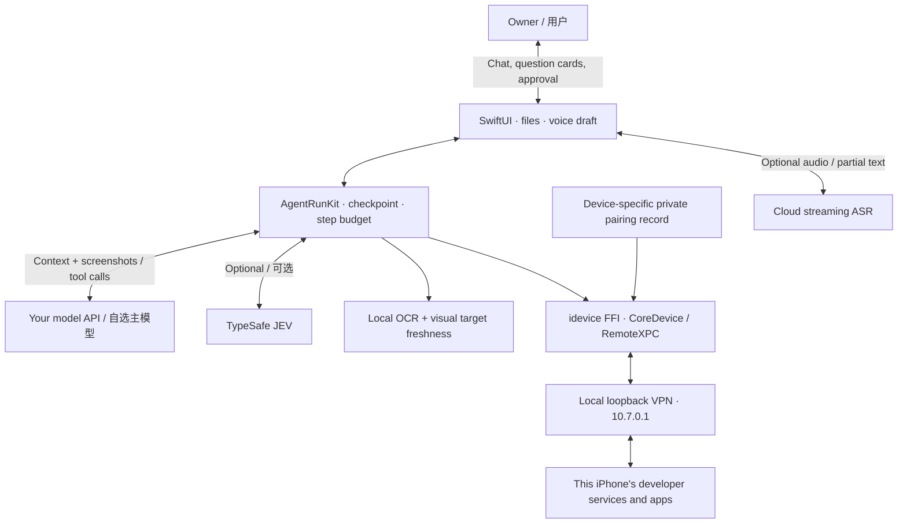

# Architecture / 技术架构

Roubao 2.0 runs the agent harness and control client on the iPhone being controlled. Cloud model inference remains external. It uses developer services rather than WDA, Appium, an accessibility-tree API, or an external HID controller.

肉包把任务循环与控制客户端放在被控制的 iPhone 本机；模型推理使用用户配置的服务。运行时不用 WDA、不用电脑托管，也没有把本地 OCR 当成完整系统控件树。

## Main components / 主要组件

| Location | Responsibility |
|---|---|
| `iPhoneUse/Agent/PhoneAgent.swift` | Conversation UI state, registered tools, questions, files, orchestration integration |
| `iPhoneUse/Model/PhoneHarness.swift` | AgentRunKit loop, serial actions, cancellation, checkpoints, approval, budget extension |
| `iPhoneUse/Model/ModelGateway.swift` | SwiftOpenAI-compatible model transport |
| `iPhoneUse/Model/JevActor.swift` | Optional plan execution using current-frame OCR candidates; uncertainty returns to primary model |
| `PhoneStallMonitor`, `PhoneVisualFreshness`, `PhoneVisualTarget` | Structural page progress, target freshness, one-use image grounding |
| `PhoneAuthorization`, `PhoneFinalActionGuard` | Scoped owner approval, duplicate/unknown submission handling, observed final-action label guards |
| `iPhoneUse/Device/` | Pairing import, tunnel, DDI, screenshot, touch, pasteboard, app launch |
| `idevice-patch/` | Rust device service additions; built against pinned upstream idevice |
| `TunnelProvider/` | Local packet tunnel; optional external LocalDevVPN mode for free signing |
| `TaskReportRenderer`, `TaskFileAccess`, `TaskFilesView` | Native PDFs, scoped file IDs, text extraction, QuickLook, sharing |
| `AgentWidget/`, `Shared/` | Live Activity, Dynamic Island, owner Stop action |
| `VolcASR`, `VoiceDraft`, `ASRSettings` | Streaming speech recognition and editable drafts |

## Recovery principles / 恢复原则

The primary model owns planning, failure recovery, and final review. Two failed grounding attempts require fresh primary-model image grounding. Dynamic banners must not count as structural navigation. A located target is one-use and checked against the current target neighborhood/page. A known nonretryable JEV error disables that route for the run, without removing the primary tool set.

主模型负责规划、异常恢复和完成复核。达到步数上限时由用户选择延长，而不是自动宣布失败。问答、审批、任务文件和检查点按会话/任务目录关联；报告生成后仍可继续。外部操作与持久化不能保证原子性，不能承诺 exactly-once。

## Cellular connection / 蜂窝连接

Some iOS paths refuse a new loopback connection while cellular is active. The app first tries directly, then optionally invokes a user-installed shortcut to disable cellular briefly, establish the local connection, and restore cellular. No Wi-Fi network is required; cloud calls still need working internet. Both success and failure paths attempt data restoration. See the bilingual installation guides for setup and verification.

## Dependencies and source / 依赖来源

SwiftPM revisions are recorded in both `Package.resolved` files. Rust is pinned in `scripts/build-idevice.sh`. The upstream application and source provenance are listed in [THIRD_PARTY_NOTICES.md](../THIRD_PARTY_NOTICES.md). No Apple DDI image, signing identity, pairing record, or model key is bundled in source.
